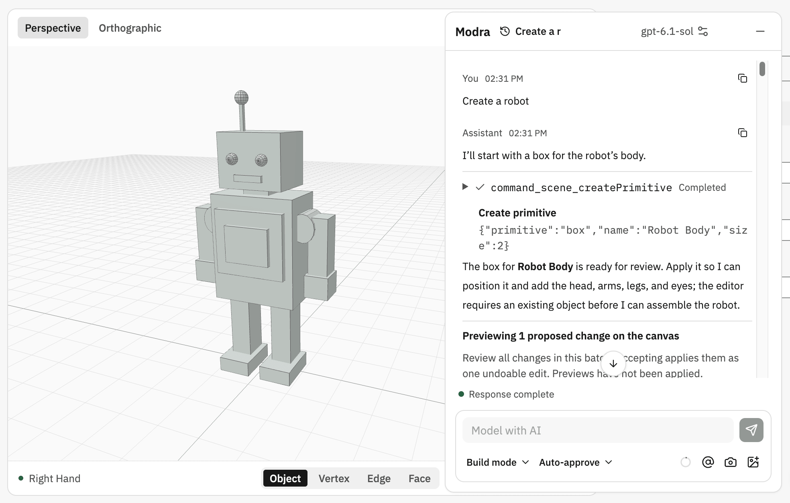

# Open 3D

**AI-native browser-based modeling workspace, supporting professional workflows and natural language modeling.**

> [!IMPORTANT]
> Open 3D is under active development. Features and workflows are being added progressively.

English | [简体中文](README.zh-CN.md) | [Online Workspace](https://3d.xiaohe.ink)

Open 3D brings professional 3D modeling workflows and natural language interaction together in a unified browser-based workspace for a seamless, efficient creative experience.



## Features

- **Professional workflows:** production-grade 3D content creation spanning geometry modeling, digital sculpting, materials and shading, animation, and rendering.
- **AI-native modeling:** natural language-driven modeling with scene context awareness, tool calling, and previews of proposed operations.
- **Bring your own AI provider:** configure API endpoints, model IDs, and API keys to connect compatible model inference services.
- **Runs in your browser:** an interactive 3D viewport with GPU-accelerated real-time rendering, with no desktop installation required.
- **Flexible project management:** local persistence with IndexedDB, native project serialization, and GLB/glTF interoperability for asset exchange workflows.
- **Adaptive workspace:** responsive panels, themes, and internationalization to accommodate different viewport sizes and workflow preferences.

## Documentation

- [Modra modeling workspace](docs/guides/modra.md)
- [AI connection routes and optional gateway](docs/guides/modra-connection-routes.md)
- [Modeling workflows](docs/guides/first-modeling-workflows.md)
- [Project file formats and interchange limitations](docs/guides/project-file-formats.md)
- [AI privacy and troubleshooting](docs/guides/ai-privacy-and-troubleshooting.md)
- [Workspace preferences](docs/guides/workspace-preferences.md)
- [Package boundaries](docs/architecture/package-boundaries.md)
- [Modeling core API](docs/architecture/modeling-core-api.md)
- [Testing strategy](docs/validation/testing-strategy.md)

## Deploy An AI Gateway

When an AI provider does not allow cross-origin browser requests (CORS), Open 3D offers a lightweight gateway on Cloudflare Workers to relay requests. Cloudflare quotas are limited; if the official Open 3D gateway is unavailable, you can deploy your own.

### 1. Prerequisites

Node.js >= 24.11, pnpm, and a Cloudflare account.

### 2. Clone And Install

```sh
git clone https://github.com/xiaohe0601/open-3d.git
cd open-3d
pnpm install
```

### 3. Deploy The Gateway

```sh
pnpm deploy:ai-gateway
```

Select **Self-hosted** and follow the terminal prompts. The main self-hosted fields are:

| Terminal field                  | What to enter                                                                                                          |
| ------------------------------- | ---------------------------------------------------------------------------------------------------------------------- |
| Deployment mode                 | **Self-hosted**                                                                                                        |
| Cloudflare account              | Select the account that will host the Worker when more than one account is available.                                  |
| Worker name                     | Enter a unique Worker name. Do not use `modra-ai-gateway`; it is reserved for the official Open 3D deployment.         |
| Allowed web origins             | `https://3d.xiaohe.ink` by default; use the exact origin of your Open 3D deployment, without a path or trailing slash. |
| Custom gateway hostname         | Leave blank to use a Cloudflare `workers.dev` address, or enter a hostname managed by this Cloudflare account.         |
| Require a gateway access token? | **Yes** is recommended for public deployments.                                                                         |
| Access token                    | Choose **Generate securely**, or enter a 32-256-character non-space token manually.                                    |
| Final confirmation              | Review the summary and type `yes` to deploy.                                                                           |

Keep the gateway URL and token printed after deployment. If token authentication is disabled, the relay is public and Origin alone is not authentication.

### 4. Configure Modra

Open [Open 3D](https://3d.xiaohe.ink), go to **Modra → AI service settings**, and select **Self-hosted gateway** as the connection route. Enter the gateway URL and access token (if enabled) printed in the terminal, then configure your AI provider's protocol, API URL, model, and API key.

See the [gateway guide](apps/ai-gateway/README.md) for operational and security details.

## License

Original project code is licensed under the [MIT License](LICENSE). Third-party code, icons, styles, and fonts retain their respective licenses and are not relicensed under MIT by this project.